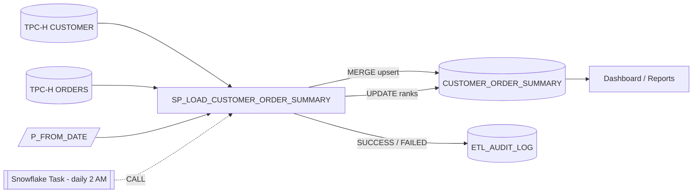

Snowflake Stored Procedure: Incremental Customer Order Summary Load
A real-world style ETL stored procedure built in Snowflake SQL Scripting using the free TPC-H sample data (`SNOWFLAKE_SAMPLE_DATA.TPCH_SF1`).
The procedure builds and maintains a `CUSTOMER_ORDER_SUMMARY` table that a dashboard could read from. It shows each customer's order count, total spend, last order date and rank within their market segment.
---
Table of Contents
Business Problem
Concepts Covered
Project Structure
Data Flow
Source and Target Tables
Stored Procedure Explained Step by Step
How to Run
Expected Results
Scheduling with a Snowflake Task
Common Errors and Fixes
Interview Questions from This Project
Possible Enhancements
---
Business Problem
The business wants a customer-level summary for reporting: how many orders each customer placed, how much they spent, when they last ordered, and who the top customers are in each market segment.
Recalculating everything from millions of order rows every time a dashboard opens is slow and costly.
Solution: a stored procedure that pre-computes the summary into a table, loads only what changed (incremental load), can safely be re-run, and records every run in an audit log.
---
Concepts Covered
Stored procedures in Snowflake SQL Scripting (`DECLARE`, `BEGIN ... END`, `EXCEPTION`)
Input parameters and variables, bind variables (`:variable`)
Input validation with `IF`
Incremental loading using a date parameter
Idempotent upserts with `MERGE` (`WHEN MATCHED` / `WHEN NOT MATCHED`)
Aggregations with `COUNT`, `SUM`, `MAX` and `GROUP BY`
Window function `DENSE_RANK()` with `PARTITION BY`
Transactions: `BEGIN TRANSACTION`, `COMMIT`, `ROLLBACK`
Error handling with `EXCEPTION WHEN OTHER` and `SQLERRM`
Audit logging for production support
`SQLROWCOUNT` to capture rows affected
Scheduling with Snowflake Tasks and CRON
---
Project Structure
```
snowflake-customer-order-summary/
├── README.md
└── sql/
    ├── 01_setup.sql                          # Create database and schema
    ├── 02_create_tables.sql                  # Target table + audit log table
    ├── 03_sp_load_customer_order_summary.sql # The stored procedure
    ├── 04_run_and_validate.sql               # Run the procedure and validate output
    ├── 05_schedule_task.sql                  # (Optional) Schedule daily with a Task
    └── 06_cleanup.sql                        # (Optional) Drop all objects
```
Run the scripts in numeric order.
---
Data Flow

---
Source and Target Tables
Source (read-only, shared by Snowflake)
Table	Key columns used
`SNOWFLAKE_SAMPLE_DATA.TPCH_SF1.CUSTOMER`	`C_CUSTKEY`, `C_NAME`, `C_MKTSEGMENT`
`SNOWFLAKE_SAMPLE_DATA.TPCH_SF1.ORDERS`	`O_ORDERKEY`, `O_CUSTKEY`, `O_TOTALPRICE`, `O_ORDERDATE`
`SNOWFLAKE_SAMPLE_DATA` is a shared database, so nothing can be created inside it. That is why this project creates its own `PRACTICE_DB.ETL` schema and reads the sample tables using fully qualified names.
Target (created by this project)
`CUSTOMER_ORDER_SUMMARY`: one row per customer.
Column	Meaning
`C_CUSTKEY`	Customer key (business key used to match in `MERGE`)
`C_NAME`	Customer name
`C_MKTSEGMENT`	Market segment (AUTOMOBILE, BUILDING, FURNITURE, HOUSEHOLD, MACHINERY)
`ORDERS_COUNT`	Number of orders placed
`TOTAL_SPEND`	Sum of order total price
`LAST_ORDER_DATE`	Most recent order date
`SEGMENT_RANK`	Rank by total spend within the segment (1 = highest)
`UPDATED_AT`	When this row was last inserted/updated
`ETL_AUDIT_LOG`: one row per procedure run.
Column	Meaning
`RUN_ID`	Auto-incrementing run id
`PROC_NAME`	Procedure name
`START_TIME` / `END_TIME`	Run duration
`STATUS`	`SUCCESS` or `FAILED`
`ROWS_AFFECTED`	Rows inserted/updated by `MERGE`
`ERROR_MESSAGE`	Error text when the run fails
---
Stored Procedure Explained Step by Step
Full code: `sql/03_sp_load_customer_order_summary.sql`
1. Procedure header
```sql
CREATE OR REPLACE PROCEDURE SP_LOAD_CUSTOMER_ORDER_SUMMARY(P_FROM_DATE DATE)
RETURNS VARCHAR
LANGUAGE SQL
AS
$$ ... $$;
```
`CREATE OR REPLACE` lets you redeploy changes without dropping the procedure first.
`P_FROM_DATE DATE` is the input parameter. The procedure reprocesses every customer who placed an order on or after this date.
`RETURNS VARCHAR` means the procedure returns a status message such as `SUCCESS: 99996 rows merged`.
`LANGUAGE SQL` means Snowflake Scripting (Snowflake also supports JavaScript, Python, Java and Scala procedures).
`$$ ... $$` wraps the body so the semicolons inside it don't end the `CREATE` statement early.
2. Variable declarations
```sql
DECLARE
    v_start  TIMESTAMP DEFAULT CURRENT_TIMESTAMP();
    v_rows   NUMBER    DEFAULT 0;
    v_err    VARCHAR;
```
`v_start` captures when the run began, for the audit log.
`v_rows` stores how many rows the `MERGE` touched.
`v_err` stores the error message if something fails.
Inside SQL statements, variables are referenced with a colon, e.g. `:v_start`. In plain scripting statements (like `v_rows := SQLROWCOUNT`) no colon is needed.
3. Input validation
```sql
IF (P_FROM_DATE IS NULL OR P_FROM_DATE > CURRENT_DATE()) THEN
    RETURN 'FAILED: invalid P_FROM_DATE';
END IF;
```
Rejects bad calls (NULL or future dates) before doing any work.
Fails fast with a clear message instead of running a pointless or harmful load.
4. Start a transaction
```sql
BEGIN TRANSACTION;
```
Groups the `MERGE`, the rank `UPDATE` and the audit `INSERT` into one unit of work.
Either all of them are saved (`COMMIT`) or none are (`ROLLBACK`), so the summary table is never left half-updated.
5. Incremental, idempotent upsert with MERGE
```sql
MERGE INTO CUSTOMER_ORDER_SUMMARY tgt
USING ( ...aggregated source query... ) src
ON tgt.C_CUSTKEY = src.C_CUSTKEY
WHEN MATCHED THEN UPDATE SET ...
WHEN NOT MATCHED THEN INSERT ...;
```
The source query:
Finds customers who ordered on or after `P_FROM_DATE` (the `IN (SELECT DISTINCT O_CUSTKEY ...)` subquery). This is the incremental part: only these customers are reprocessed.
For those customers, recalculates metrics over all their orders (not just recent ones), so totals are always complete and correct.
`COUNT(O_ORDERKEY)` gives order count, `SUM(O_TOTALPRICE)` gives total spend, `MAX(O_ORDERDATE)` gives last order date.
Groups by `C_CUSTKEY` (unique key) together with `C_NAME` and `C_MKTSEGMENT`, so customers who share a name are never merged together.
The MERGE logic:
`ON tgt.C_CUSTKEY = src.C_CUSTKEY` matches source rows to existing summary rows by customer key.
`WHEN MATCHED` means the customer already exists, so their metrics are updated.
`WHEN NOT MATCHED` means it's a new customer, so a row is inserted.
Why MERGE matters: running the procedure twice with the same date gives the same result, with no duplicates. This property is called idempotency and is essential for safe re-runs and backfills.
6. Capture rows affected
```sql
v_rows := SQLROWCOUNT;
```
`SQLROWCOUNT` is a built-in variable holding the number of rows affected by the last DML statement.
Saved for the audit log and the return message.
7. Recalculate segment ranks
```sql
UPDATE CUSTOMER_ORDER_SUMMARY tgt
SET SEGMENT_RANK = r.RNK
FROM (
    SELECT C_CUSTKEY,
           DENSE_RANK() OVER (PARTITION BY C_MKTSEGMENT
                              ORDER BY TOTAL_SPEND DESC) AS RNK
    FROM CUSTOMER_ORDER_SUMMARY
) r
WHERE tgt.C_CUSTKEY = r.C_CUSTKEY;
```
`PARTITION BY C_MKTSEGMENT` restarts ranking at 1 for each market segment.
`ORDER BY TOTAL_SPEND DESC` means highest spender = rank 1.
`DENSE_RANK()` gives tied customers the same rank without gaps (2, 2, 3 rather than 2, 2, 4).
Why ranking is a separate step: if ranks were calculated inside the `MERGE` source, they would only compare the customers being reloaded in that run, giving wrong ranks during incremental loads. Ranking must be done across the entire summary table after the merge.
8. Log success and commit
```sql
INSERT INTO ETL_AUDIT_LOG (...) VALUES ('SP_LOAD_CUSTOMER_ORDER_SUMMARY', :v_start, CURRENT_TIMESTAMP(), 'SUCCESS', :v_rows);
COMMIT;
RETURN 'SUCCESS: ' || v_rows || ' rows merged';
```
Writes a SUCCESS record with start/end time and rows affected.
`COMMIT` makes all changes permanent.
Returns a readable status message to the caller.
9. Error handling
```sql
EXCEPTION
    WHEN OTHER THEN
        ROLLBACK;
        v_err := SQLERRM;
        INSERT INTO ETL_AUDIT_LOG (...) VALUES (..., 'FAILED', :v_err);
        RETURN 'FAILED: ' || v_err;
```
`WHEN OTHER` catches any error raised in the `BEGIN` block.
`ROLLBACK` undoes any partial changes from the failed run.
`SQLERRM` holds the error message text. It's copied into `v_err` and saved to the audit log.
The failure log is written after the rollback, so it is kept even though the load was undone.
Production support can check `ETL_AUDIT_LOG` to see exactly when and why a run failed.
---
How to Run
Prerequisites: a Snowflake account (a free trial works) with access to `SNOWFLAKE_SAMPLE_DATA`, and a role that can create databases (e.g. `SYSADMIN`).
Setup: run `sql/01_setup.sql` to create `PRACTICE_DB.ETL`.
Tables: run `sql/02_create_tables.sql`.
Procedure: run `sql/03_sp_load_customer_order_summary.sql`. In Snowsight, place the cursor inside the `CREATE PROCEDURE` block and run it as a single statement.
Run and validate: run the statements in `sql/04_run_and_validate.sql` one by one.
Optional: schedule with `sql/05_schedule_task.sql`, clean up with `sql/06_cleanup.sql`.
> **Note:** TPC-H order dates range from **1992-01-01 to 1998-08-02**. Use dates in that range when testing (e.g. `'1992-01-01'` for a full load, `'1998-07-01'` for an incremental one).
---
Expected Results
Call	Expected result
`CALL SP_LOAD_CUSTOMER_ORDER_SUMMARY('1992-01-01');`	Full load, about 100K customers merged
`CALL SP_LOAD_CUSTOMER_ORDER_SUMMARY('1998-07-01');`	Smaller incremental load
Same incremental call again	Same row count reported, table data unchanged (idempotent)
`CALL SP_LOAD_CUSTOMER_ORDER_SUMMARY(NULL);`	`FAILED: invalid P_FROM_DATE`
Validation checks in `04_run_and_validate.sql`:
Top 5 customers per segment by spend
No duplicate customers (`COUNT(*)` = `COUNT(DISTINCT C_CUSTKEY)`)
Reconciliation: total `ORDERS_COUNT` in summary equals total rows in source `ORDERS` (1,500,000 for `TPCH_SF1`)
Audit log shows each run with status and timing
---
Scheduling with a Snowflake Task
```sql
CREATE OR REPLACE TASK TASK_DAILY_CUSTOMER_SUMMARY
    WAREHOUSE = COMPUTE_WH
    SCHEDULE  = 'USING CRON 0 2 * * * Asia/Kolkata'
AS
    CALL SP_LOAD_CUSTOMER_ORDER_SUMMARY(DATEADD(day, -3, CURRENT_DATE()));
```
Runs every day at 2 AM IST.
Loads the last 3 days instead of just yesterday. The overlap catches late-arriving orders, and `MERGE` makes the overlap harmless.
Tasks are created suspended: `ALTER TASK ... RESUME` starts the schedule.
Since TPC-H data ends in 1998, the scheduled run will merge 0 rows here. In a live system the source keeps growing.
Suspend the task when you're done practicing so it doesn't keep using warehouse credits.
---
Common Errors and Fixes
Error	Cause	Fix
`Creating table on shared database 'SNOWFLAKE_SAMPLE_DATA' is not allowed`	Worksheet context is set to the sample database	Run `USE DATABASE PRACTICE_DB; USE SCHEMA ETL;`
`Object 'CUSTOMER' does not exist`	Sample tables referenced without full names	Use `SNOWFLAKE_SAMPLE_DATA.TPCH_SF1.CUSTOMER`
`Insufficient privileges to operate on account`	Role can't create databases	`USE ROLE SYSADMIN;` or ask your admin
Syntax error near `$$`	Procedure block run together with other statements	Run the `CREATE PROCEDURE` block on its own
`0 rows merged`	Date outside TPC-H range	Use a date between 1992-01-01 and 1998-08-02
Task fails to execute	Missing privilege or wrong warehouse	Grant `EXECUTE TASK`; check name with `SHOW WAREHOUSES;`
---
Interview Questions from This Project
How do you make a load re-runnable? Use `MERGE` (upsert) on a business key so re-running produces the same result without duplicates.
What is an incremental load? Processing only new/changed data (here, customers with orders since a given date) instead of reloading everything.
Why load the last 3 days instead of 1? To catch late-arriving or corrected data. Idempotent `MERGE` makes the overlap safe.
Why use a transaction? So a failure midway doesn't leave the target partially updated.
How do you monitor a stored procedure in production? With an audit log table capturing start/end time, status, rows affected and error messages.
ROW_NUMBER vs RANK vs DENSE_RANK? `ROW_NUMBER` always gives unique numbers; `RANK` gives ties the same number and skips the next; `DENSE_RANK` gives ties the same number without skipping.
Why compute ranks after the MERGE rather than in it? Ranks in an incremental subset only compare that subset, so they'd be wrong; ranking the full table gives correct results.
Why GROUP BY customer key and not name? Names aren't guaranteed to be unique; grouping by name could merge different customers.
---
Possible Enhancements
Add a watermark table that stores the last successful load date, so the procedure picks its own start date instead of taking a parameter.
Use Snowflake Streams on the source table for true change data capture (CDC).
Add data quality checks (null keys, negative prices) that fail the run if thresholds are breached.
Send email alerts on failure using a notification integration.
Convert `CUSTOMER_ORDER_SUMMARY` into an SCD Type 2 dimension to keep history of segment changes.
Parameterize the source schema (`TPCH_SF1`, `TPCH_SF10`, ...) to test performance at larger scale.
---
Tech Stack
Snowflake (Snowsight worksheets)
Snowflake SQL Scripting
TPC-H benchmark sample data
